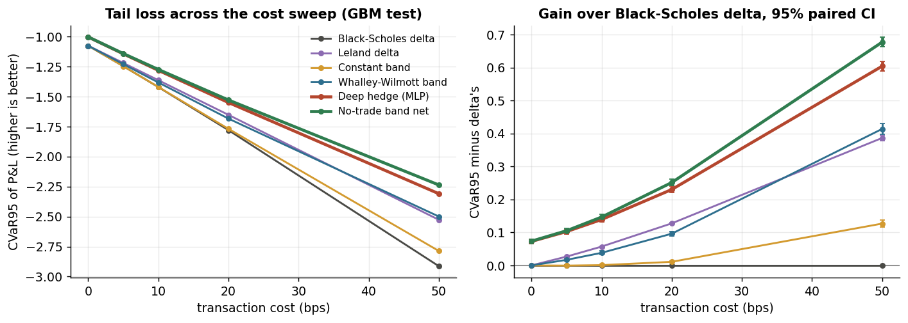
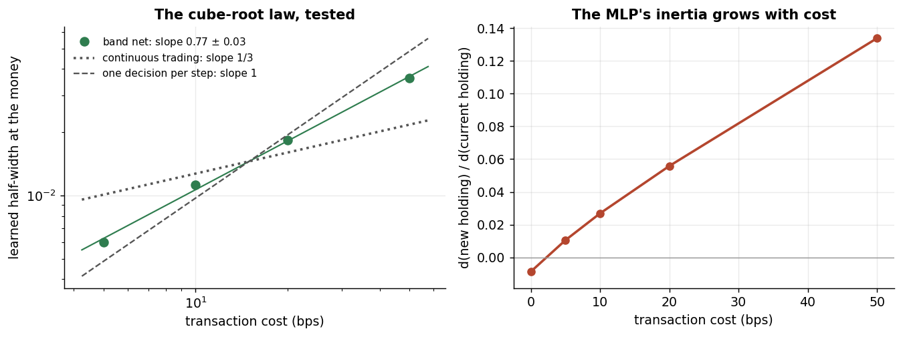
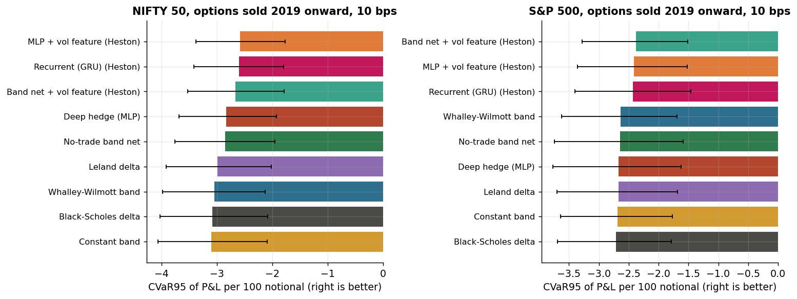

# Deep hedging under transaction costs

**ES 335 Machine Learning, IIT Gandhinagar.** Param Tanna (24110236) and Pranav Magarde (24110269).

Project website: **https://paramtanna.github.io/deep-hedging/** (interactive figures, full write-up)

We sell a 30-day at-the-money call option on an equity index and hedge it once a day. Black-Scholes says exactly how much of the index to hold, but only if trading is free. With a proportional transaction cost there is no formula for the best strategy. We train neural network policies to minimise the tail risk of the hedged position directly, compare them with Black-Scholes delta and two cost-aware rules from the literature, and test everything on held-out simulations and on real NIFTY 50 and S&P 500 history from 2019 onward. We also check whether the network rediscovers the no-trade band that theory predicts, without being told it exists.

**Results in brief.**

* **In simulation the networks beat every rule, at every cost.** On 100,000 held-out GBM episodes at 10 bps, the MLP and the no-trade band network cut the tail loss (CVaR at 95%) of Black-Scholes delta hedging by 9.8% and 10.3%, and beat the best rule there, Leland's, by 6.0% and 6.6%, with paired 95% intervals that exclude zero. At 50 bps the band network beats the best rule, Whalley-Wilmott, by 10.5%.
* **On real markets, the simulator decides the outcome.** On NIFTY 50 and S&P 500 options sold from 2019 on, networks trained only on our calibrated Heston simulator cut delta's tail loss by 14% to 16% (NIFTY) and 11% to 12% (S&P), every interval excluding zero. They lead the best tuned rule by 11% and 8%, significantly for one network per index. Trained on plain GBM, the same networks transfer much less well: 8% better than delta on NIFTY, and on the S&P 2%, indistinguishable from zero.
* **What they learned can be read.** The MLP hedges like delta at a higher volatility: 1.14 times the true one at zero cost, more as cost rises, in the direction of Leland's rule but not of its form. A one-line rule built from that reading recovers 87% of its advantage at 10 bps. The band network's width grows like cost to the power 0.77, not the textbook 1/3, because with daily rebalancing delta moves further in one day than the whole band; the tuned rules show the same.
* **The clearest failure has a date.** On 18 May 2009 NIFTY rose 18% in one day. The Heston simulator practically never produces a jump like that, and the networks trained on it lost more than delta in the windows that contain it.

## Where to find each part

| Required section | Website | Notebook |
|---|---|---|
| Problem and research question | [1](https://paramtanna.github.io/deep-hedging/#question) | introduction |
| Data source and description | [2](https://paramtanna.github.io/deep-hedging/#data) | section 1 |
| Preprocessing | [3](https://paramtanna.github.io/deep-hedging/#prep) | sections 3 and 4 |
| Baseline and methods | [4](https://paramtanna.github.io/deep-hedging/#methods) | section 5 |
| Evaluation strategy | [5](https://paramtanna.github.io/deep-hedging/#eval) | sections 2 and 6 |
| Results | [6](https://paramtanna.github.io/deep-hedging/#results) | sections 6 to 8 |
| Error analysis | [7](https://paramtanna.github.io/deep-hedging/#errors) | section 9 |
| Limitations | [8](https://paramtanna.github.io/deep-hedging/#limits) | |
| Conclusion | [9](https://paramtanna.github.io/deep-hedging/#conclusion) | |
| Reproduction steps | [10](https://paramtanna.github.io/deep-hedging/#reproduce) | this README |

## The question

For a short 30-day at-the-money call, rebalanced daily under a proportional transaction cost, which hedging policy gives the best tail outcome, measured by **CVaR at 95% of terminal profit and loss net of all fees**? And does a neural policy trained only on that objective learn the no-trade structure that cost-aware rules build in by hand?

* **Unit of analysis.** One episode: one option sold and hedged to expiry. Inside it the policy makes 30 decisions, one per trading day.
* **Target.** None in the supervised sense. Nobody knows the right hedge under costs, which is the whole problem. Policies are judged by the distribution of terminal P&L.
* **Information at decision time.** Prices up to today, the current holding, time to expiry, the volatility quoted at the sale, recent realised volatility. Never a future price; `src/controls.py` and the policy tests check this by perturbing future prices.
* **Limits of the claim.** One contract type, proportional costs without market impact, zero rates and dividends, a volatility quote estimated from past returns (we have no option market data), and a real test period of about seven years.

## Why this is hard, from first principles

1. **Delta hedging cancels only the first-order risk.** Over one step, `dC = Delta dS + (1/2) Gamma dS^2 + Theta dt`. Holding `Delta` units cancels the first term. What is left, `(1/2) Gamma S^2 (sigma^2 dt - r_t^2)`, has mean zero if the volatility you quoted is the one that happens, and its standard deviation shrinks like `sqrt(dt)`. Rebalance four times as often and the error halves. Our engine reproduces this (tail risk falls from -1.006 to -0.506 between 30 and 120 rebalances at 20% volatility).
2. **Costs make continuous hedging infinitely expensive.** Each step delta moves by about `Gamma dS`, so you trade about `Gamma S sigma sqrt(dt)` and pay `k` times that. Over `T/dt` steps the bill grows like `1/sqrt(dt)`. Error shrinks with frequency, cost grows with it, and the best balance depends on the cost.
3. **Trade when it matters, not on a clock.** Let the holding drift up to `H` from delta before trading. The risk you carry grows like `H^2`; the rate at which you hit the band edge and pay falls like `1/H`. Minimising their sum gives `H^3 proportional to k S Gamma^2 / gamma`, so **the optimal band width grows like cost^(1/3)**. This is the Whalley-Wilmott band. The argument assumes continuous trading, where the holding drifts smoothly into the band edge; with one decision a day the band can grow faster, and in Results we measure that it does.
4. **Why learn.** That result is asymptotic in small costs, uses exponential utility instead of tail risk, assumes continuous monitoring and a known volatility. Our problem is the exact one: CVaR of a 30-step daily hedge with a volatility that has to be guessed. A policy trained on that objective optimises what we actually care about.

## Data

| | NIFTY 50 | S&P 500 |
|---|---|---|
| Source | Yahoo Finance chart endpoint, symbol `^NSEI` | same, `^GSPC` |
| Rows | one trading day | one trading day |
| Range used | 2007-09-17 to 2026-11-13 | 2000-01-03 to 2026-11-13 |
| Columns used | date, adjusted close | date, adjusted close |

Access: no key or login. `src/data.py` builds the request; the URL is in the code. **Raw prices are not stored in this repository**; `python src/experiments.py prepare` downloads them into `data/raw/`. The website only shows paths rescaled to 100 at each sale date.

Quality findings that shaped the analysis: Yahoo's NIFTY history starts in 2007 (our proposal assumed 2000); the 31 dropped NIFTY rows are exchange holidays emitted as empty rows (one is 27 November 2008, during the Mumbai attacks); the longest S&P gap is the post-9/11 closure and is kept as a genuine return; adjusted close equals close (price indices, no dividends); NIFTY volume is mostly unreported and is never used. Returns have excess kurtosis of 12 (NIFTY) and 8.5 (S&P) before 2019, and the Ljung-Box statistic on absolute returns is in the thousands against a critical value of 31.4: fat tails and strong volatility clustering, both of which plain GBM rules out.

## Method

**Episodes.** Every data source goes through one protocol: 60 trading days of history, then 30 days of hedging. At the sale the desk quotes the realised volatility of the history, prices the call with Black-Scholes, collects the premium and hedges. Paths are rescaled to 100 at the sale; the strike is 100.

**Split.** Time split at 2019-01-01, made before anything was fitted. Every parameter estimated from data uses pre-2019 returns only. Real test = every episode sold from 2019 onward.

**Simulators.** GBM with each path's volatility drawn from the 7,419 trailing 60-day volatilities seen before 2019, and Heston with stochastic volatility. Our first Heston fit matched daily moments and turned out to be badly wrong for hedging: to make daily tails fat it pushed vol-of-vol to about 2, so a month's realised volatility overshot the quote far more often than in reality. We refit by simulated method of moments on the statistic that actually drives hedging P&L, the distribution of realised over quoted volatility at the 30-day horizon. Vol-of-vol fell to 0.74 (NIFTY) and 0.91 (S&P), the leverage effect came out negative for both, the Feller condition now holds, and the tail loss of plain delta hedging in the simulator matches the real training era within a few percent, although that loss was never a calibration target.

**Strategies.**

| | Idea | Free parameter |
|---|---|---|
| Unhedged | hold nothing | none |
| Black-Scholes delta | hold N(d1) every day | none |
| Leland delta | delta at a cost-inflated volatility | none |
| Constant band | trade back to delta when the drift exceeds `w` | `w`, tuned on validation |
| Whalley-Wilmott | gamma-dependent band, trade to its edge | `gamma`, tuned on validation |
| MLP (deep hedging) | network maps state and current holding to a holding; nothing about bands built in | weights |
| No-trade band network | network outputs a band, hedge = clamp(holding, band) | weights |
| GRU | recurrent network reading the return history, for worlds where volatility is hidden | weights |

The networks are trained without labels. A batch of 8,192 episodes is simulated, the policy makes all 30 decisions, the same accounting engine that scores the baselines computes the P&L, and the gradient of its CVaR flows back through every decision. The CVaR is written in the Rockafellar-Uryasev form, and the VaR level inside it is set on every batch to that batch's 95% quantile, which is its exact minimiser (section "What went wrong" explains why we stopped learning it). Every network, the GRU included, gets the same budget: 1,500 iterations of Adam with cosine decay at batch 8,192. The checkpoint with the best validation CVaR is kept.

## Evaluation design

* **Validation** 20,000 simulated episodes (seed 1001) select every checkpoint and every rule parameter. **Simulated test** 100,000 episodes (seed 2002) and the **real test** (2019 onward) are scored once, at the end.
* Every strategy is scored by the same engine on the same paths, with the same cost and premium. Rules are tuned on the same validation set as the networks they are compared with.
* **Metric:** CVaR at 95% of terminal P&L net of fees, per 100 notional. Also mean, standard deviation, fees and trade count.
* **Uncertainty:** paired bootstrap intervals for every CVaR and every difference from delta. Real windows overlap by 29 of 30 days, so real-data intervals use a moving-block bootstrap with 30-day blocks.
* **Controls** that must pass before any result is trusted: `python src/controls.py` runs ten (Greeks against finite differences, the `sqrt(dt)` law, zero mean P&L at zero cost, limiting cases of every rule, causality). We also train the network at zero cost, where the answer is known to be close to Black-Scholes delta.

## Results

All numbers are CVaR at 95% of terminal P&L per 100 of notional, net of all fees (higher, that is less negative, is better), with 95% bootstrap intervals that are paired across strategies. They come from `results/metrics.json` and `results/analysis.json`; the website draws the same files.

### 1. Simulation: every rule beaten, at every cost

GBM, 100,000 test episodes, 10 bps:

| Strategy | CVaR95 [95% CI] | Gain over delta [95% CI] | Mean P&L | Fees | Trades per episode |
|---|---|---|---|---|---|
| Unhedged | -13.371 [-13.610, -13.144] | [-12.189, -11.711] | -0.011 | 0.000 | 0.0 |
| Black-Scholes delta | -1.420 [-1.439, -1.402] |  | -0.273 | 0.274 | 28.0 |
| Leland delta | -1.363 [-1.381, -1.345] | [0.055, 0.059] | -0.267 | 0.267 | 28.2 |
| Constant band | -1.419 [-1.438, -1.400] | [-0.002, 0.004] | -0.262 | 0.263 | 18.6 |
| Whalley-Wilmott band | -1.381 [-1.401, -1.362] | [0.034, 0.044] | -0.227 | 0.228 | 22.4 |
| MLP (trained on GBM) | -1.280 [-1.297, -1.264] | [0.132, 0.147] | -0.252 | 0.253 | 28.5 |
| Band network (trained on GBM) | -1.273 [-1.289, -1.256] | [0.139, 0.155] | -0.236 | 0.237 | 25.8 |

Across the cost sweep, against the best rule at each cost:

| Cost (bps) | Delta | Best rule | MLP | Band network | Band network vs best rule [95% CI] |
|---|---|---|---|---|---|
| 0 | -1.075 | -1.075 (every rule is delta) | -1.003 | -1.002 | [0.068, 0.080] |
| 5 | -1.246 | -1.219 (Leland delta) | -1.143 | -1.140 | [0.072, 0.085] |
| 10 | -1.420 | -1.363 (Leland delta) | -1.280 | -1.273 | [0.083, 0.097] |
| 20 | -1.779 | -1.651 (Leland delta) | -1.549 | -1.528 | [0.116, 0.132] |
| 50 | -2.913 | -2.499 (Whalley-Wilmott band) | -2.309 | -2.236 | [0.253, 0.274] |



### 2. What the networks learned

* **The MLP hedges like delta at a higher volatility.** Fitting one effective volatility to where it rests gives 1.14 times the true volatility at zero cost and 1.47 times at 50 bps. The zero-cost part is a tail-risk trade: hedging at a higher volatility costs a fixed amount on every path and pays back on paths that stay near the strike, which are the paths where daily rebalancing leaks most. Delta at a scaled volatility has its best tail near a scale of 1.1 to 1.15, where the network sits, and recovers 78% of the network's zero-cost gain. With costs, the extra inflation grows linearly in the cost, as Leland's does, but hardly depends on the level of volatility, where Leland's falls like 1/sigma. Leland's rule with its volatility scaled by 1.14 recovers 87% of the MLP's advantage over delta at 10 bps and 76% at 50 bps (validation set). The rest is inertia: the MLP leaves part of the gap to its target open, more so as cost rises.
* **The band network's width does not follow the cube-root law, and should not.** Its half-width at the money grows from 0.006 at 5 bps to 0.036 at 50 bps, exponent 0.77 (standard error 0.03). Refitting the tuned constant band and Whalley-Wilmott band gives 0.53 and 0.65. The cube root assumes the holding drifts smoothly into the band; here delta moves about 0.10 in one day at the money, more than the whole band, so the trade-off is made one step at a time and the threshold grows more like the cost itself.
* **Zero-cost control and martingale check.** Trained without costs, the MLP stays within 0.07 of delta everywhere on the test set. Every strategy's zero-cost mean P&L is statistically zero (largest |z| 0.75); the MLP's validation mean had been 2.5 standard errors above zero, the selection bias of keeping the best of 61 checkpoints, and on the test set it is 0.5.



### 3. Real markets, options sold from 2019 on

1910 NIFTY and 1949 S&P windows, 10 bps, moving-block bootstrap (blocks of 30 windows):

| Strategy | NIFTY 50: CVaR95 [95% CI] | S&P 500: CVaR95 [95% CI] |
|---|---|---|
| Black-Scholes delta | -3.087 [-4.030, -2.082] | -2.716 [-3.694, -1.782] |
| Leland delta | -2.992 [-3.923, -2.023] | -2.671 [-3.701, -1.682] |
| Constant band (tuned on GBM) | -3.102 [-4.070, -2.091] | -2.688 [-3.642, -1.772] |
| Whalley-Wilmott band (tuned on GBM) | -3.046 [-3.989, -2.135] | -2.633 [-3.621, -1.689] |
| Whalley-Wilmott band (tuned on Heston) | -2.905 [-3.655, -2.150] | -2.584 [-3.535, -1.666] |
| MLP (trained on GBM) | -2.833 [-3.687, -1.932] | -2.667 [-3.773, -1.622] |
| Band network (trained on GBM) | -2.857 [-3.763, -1.953] | -2.643 [-3.744, -1.590] |
| MLP + realised vol (trained on Heston) | -2.589 [-3.383, -1.770] | -2.416 [-3.359, -1.522] |
| Band network + realised vol (trained on Heston) | -2.666 [-3.535, -1.788] | -2.381 [-3.283, -1.509] |
| GRU (trained on Heston) | -2.603 [-3.416, -1.795] | -2.426 [-3.397, -1.463] |

Against the best of these rules (Whalley-Wilmott tuned on Heston on both indices, chosen by its score on the test set, which flatters it), 1 of 5 networks on NIFTY and 1 of 5 on the S&P have intervals that exclude zero. The networks trained on plain GBM are 8% (NIFTY) and 2% (S&P) better than delta; the second is indistinguishable from zero.



### 4. Error analysis

* For every hedged strategy, P&L falls as realised volatility outruns the quote (correlation -0.58 for delta on NIFTY). Hedging isolates the volatility bet; it does not remove it.
* The worst real episodes are the same for every strategy, options sold in early March 2020, and that is where the networks gain most: the S&P's worst episode loses 10.00 under delta and 6.40 under the Heston-trained GRU.
* In simulation, sorted by volatility surprise, the MLP is worse than delta in the calmest fifth of episodes and much better in the wildest fifth: a small certain cost buys protection in bad months.
* On NIFTY's calibration era (2007 to 2018) the Heston-trained networks trail delta. 83% of their worst 5% of windows were sold in 2008 or 2009, and the worst contain 18 May 2009, the first trading day after the general election result, when NIFTY rose 18%. The day before, the network held 0.65 of the index where delta held 0.74, which cost about 1.69 per 100 of notional on that window. A diffusion simulator never shows a jump like that.

### 5. Ablations

Seeds: the 10 bps test CVaR moves by at most 0.002 (MLP) and 0.004 (band network) across three seeds. Width: hidden width 8, 16, 32, 64 and 128 give -1.308, -1.287, -1.285, -1.280, -1.277. Objective: the same MLP trained on a quadratic loss improves on delta's tail by only 5.7%, against 9.8% when trained on CVaR. Interest rate: rerunning the comparison at 6.5% instead of 0 moves every strategy by less than 0.006 and leaves the ranking unchanged.

## What changed since the proposal

The submitted proposal is in [`docs/proposal.md`](docs/proposal.md). We kept its question, metric, baselines and split, and changed the following once the data and the first results were in front of us.

| Proposal said | We did | Why |
|---|---|---|
| NIFTY from 2000 | NIFTY from September 2007 | Yahoo's `^NSEI` history starts there. |
| `yfinance` | Yahoo's chart endpoint called directly | One less dependency, and the exact request is visible in the code. |
| Heston calibrated to the returns | Heston calibrated to the volatility surprise at the 30-day horizon | The first fit matched daily moments but made the tail risk of plain delta hedging 1.5 to 2 times what it really was in the training era. |
| Band and Leland as the cost-aware baselines | Also Whalley-Wilmott, whose band width is derived rather than guessed | Beating a constant band is too easy a bar; Whalley-Wilmott beat it at every nonzero cost on validation. |
| One feed-forward network | Plus the no-trade band network and a recurrent policy | To separate "does a network discover the band" from "how good is a learned band", and to handle hidden volatility. |
| About 100,000 training episodes | Fresh episodes every step: 8,192 x 1,500 per model | Simulated data is free, so there is no reason to reuse a fixed training set. |

## What went wrong, and how we caught it

Each of these was found by checking a number against what it had to be, not by luck. The commit history keeps the broken version and the fix side by side.

1. **The first simulator was right on paper and wrong for hedging.** Fitted to daily moments, it pushed vol-of-vol to about 2 to reproduce NIFTY's kurtosis. Over a month that made volatility wander far too much, and delta hedging in that world looked 1.5 to 2 times riskier than it really was on training-era data. Hedging P&L depends on realised over quoted volatility across the life of the option, so we refitted to that ratio at the 30-day horizon (`simulators.calibrate_heston_horizon`).
2. **The CVaR threshold could not reach the tail.** We first learned the VaR level by gradient descent next to the weights. Adam moves it by about one learning rate per step, so over the whole schedule it could travel at most 0.76 from its start at 0, while the true 95% VaR was 0.89 under GBM and 1.6 to 1.9 under Heston. The networks were really minimising the average of the worst 8% to 25% of outcomes, not the worst 5%. The inner minimum has a closed form, the batch quantile, so we now use it, and every model was retrained.
3. **The seed did not fix the starting weights.** Training seeded PyTorch only after the network had been built, and PyTorch starts from a different seed in every process. No model could be reproduced exactly, and the seed study varied only the training batches. Seeding now happens before the network exists; every model was retrained, and the same job trained twice now gives the same weights.
4. **The GRU read one return twice.** The return that ends at the sale date was fed both at the end of the history and at the first decision. A check that every return is read exactly once caught it.
5. **Smaller ones.** Calibration-era windows sold in December 2018 ran into January 2019, inside the test period, so they now stop at 15 November 2018. The tuned Whalley-Wilmott risk aversion sat on the edge of its grid in both Heston worlds, so the grid was widened until it did not.

## Reproducing everything

Python 3.13. Everything runs on a CPU; a GPU only makes training faster.

```bash
git clone https://github.com/ParamTanna/deep-hedging
cd deep-hedging
pip install -r requirements.txt

python src/controls.py               # ten correctness checks, all must pass
python src/experiments.py prepare    # download data, quality report, calibration (2-3 min)
python src/experiments.py tune       # band width and Whalley-Wilmott gamma, validation only
python src/experiments.py train-all  # 25 policies (see the note below on time)
python src/experiments.py evaluate   # every test number, with bootstrap intervals
python src/analysis.py               # zero-cost control, learned bands, error analysis
python src/export.py                 # data files for the website in docs/data/
python src/figures.py                # static figures in results/figures/
```

**Data access.** `prepare` downloads daily NIFTY 50 (`^NSEI`) and S&P 500 (`^GSPC`) history from Yahoo Finance's public chart endpoint (`src/data.py`); no account, API key or login is needed. The raw price files are not redistributed here (`data/raw/` is ignored by git); everything derived from them that the analysis needs, such as the calibrations, the training volatility pool and the result files, is committed.

The trained policies are committed in `results/models/`, so `evaluate`, `analysis`, `export` and `figures` run without retraining. Seeds are fixed everywhere (validation 1001, test 2002, training 0, 1, 2). `train-all` accepts `WORKERS` and `THREADS` environment variables, and `DEVICE=cuda` trains on a GPU. We trained the submitted policies on a Colab T4 GPU with `DEVICE=cuda WORKERS=2 THREADS=1`, which took about an hour (116 minutes of training split across two jobs running side by side); on a laptop CPU expect several hours. Every checkpoint records the hardware it was trained on.

## Repository map

| Path | What it holds |
|---|---|
| `src/data.py` | download, cleaning, log returns, ACF and Ljung-Box written out from their definitions |
| `src/simulators.py` | GBM, Heston (full-truncation Euler), both Heston calibrations |
| `src/samplers.py` | the episode protocol shared by simulated and real data |
| `src/engine.py` | Black-Scholes formulas, the single P&L engine, CVaR |
| `src/strategies.py` | delta, Leland, constant band, Whalley-Wilmott, all causal |
| `src/policy.py` | MLP, no-trade band network, GRU, training loop |
| `src/controls.py` | the ten correctness checks |
| `src/experiments.py` | prepare, tune, train, evaluate |
| `src/analysis.py` | zero-cost control, learned bands, the cube-root fit, error analysis |
| `src/export.py`, `src/figures.py` | website data and static figures |
| `notebooks/deep_hedging.ipynb` | the study as a narrative, with outputs |
| `results/` | every number as JSON, trained models, figures |
| `docs/` | the website (GitHub Pages serves this folder) |

## Use of AI tools

We used Claude (Anthropic) to debug the simulation, evaluate code, to check derivations, and to build the interactive website. Every number in this repository comes from code in this repository, every component passes the correctness controls, and we checked the outputs ourselves. Decisions such as discarding the first Heston calibration came from examining the results. We take responsibility for all of it and can explain any part.

## References

Grouped by the job each one does in this project.

**The method**

1. Buehler, H., Gonon, L., Teichmann, J. and Wood, B. (2019). Deep hedging. *Quantitative Finance* 19(8), 1271-1291. The whole approach: a network trained by backpropagating through a simulated P&L, with a risk measure as the loss.
2. Imaki, S., Imajo, K., Ito, K., Minami, K. and Nakagawa, K. (2021). No-transaction band network: a neural network architecture for efficient deep hedging. arXiv:2103.01775. Our band network.

**The baselines**

3. Black, F. and Scholes, M. (1973). The pricing of options and corporate liabilities. *Journal of Political Economy* 81(3), 637-654. The premium and the delta hedge.
4. Leland, H. E. (1985). Option pricing and replication with transactions costs. *Journal of Finance* 40(5), 1283-1301. The cost-adjusted volatility rule.
5. Hodges, S. D. and Neuberger, A. (1989). Optimal replication of contingent claims under transaction costs. *Review of Futures Markets* 8(2), 222-239. The exponential-utility hedging problem whose answer is a no-trade band; the risk aversion in our Whalley-Wilmott rule comes from here.
6. Whalley, A. E. and Wilmott, P. (1997). An asymptotic analysis of an optimal hedging model for option pricing with transaction costs. *Mathematical Finance* 7(3), 307-324. The closed-form band width and its cube-root law.

**The objective**

7. Rockafellar, R. T. and Uryasev, S. (2000). Optimization of conditional value-at-risk. *Journal of Risk* 2(3), 21-41. CVaR written as a minimisation over a threshold, which is how the networks are trained.

**The simulator**

8. Heston, S. L. (1993). A closed-form solution for options with stochastic volatility with applications to bond and currency options. *Review of Financial Studies* 6(2), 327-343. The stochastic volatility model.
9. Feller, W. (1951). Two singular diffusion problems. *Annals of Mathematics* 54(1), 173-182. The condition under which the variance process stays away from zero.
10. Lord, R., Koekkoek, R. and van Dijk, D. (2010). A comparison of biased simulation schemes for stochastic volatility models. *Quantitative Finance* 10(2), 177-194. The full-truncation Euler scheme we simulate with.
11. McFadden, D. (1989). A method of simulated moments for estimation of discrete response models without numerical integration. *Econometrica* 57(5), 995-1026. Simulated method of moments.
12. Duffie, D. and Singleton, K. J. (1993). Simulated moments estimation of Markov models of asset prices. *Econometrica* 61(4), 929-952. With the previous entry, the method behind our first calibration, the one we rejected.

**The data checks**

13. Ljung, G. M. and Box, G. E. P. (1978). On a measure of lack of fit in time series models. *Biometrika* 65(2), 297-303. The test for volatility clustering.
14. Cont, R. (2001). Empirical properties of asset returns: stylized facts and statistical issues. *Quantitative Finance* 1(2), 223-236. Fat tails and volatility clustering as the facts a simulator should reproduce.

**The evaluation**

15. Boyle, P. P. and Emanuel, D. (1980). Discretely adjusted option hedges. *Journal of Financial Economics* 8(3), 259-282. Hedging error shrinks like the square root of the rebalancing interval; one of our controls checks this.
16. Efron, B. (1979). Bootstrap methods: another look at the jackknife. *Annals of Statistics* 7(1), 1-26. The bootstrap.
17. Künsch, H. R. (1989). The jackknife and the bootstrap for general stationary observations. *Annals of Statistics* 17(3), 1217-1241. The moving-block bootstrap we use on overlapping real windows.

**Training the networks**

18. Cho, K., van Merriënboer, B., Gulcehre, C., Bahdanau, D., Bougares, F., Schwenk, H. and Bengio, Y. (2014). Learning phrase representations using RNN encoder-decoder for statistical machine translation. *Proceedings of EMNLP 2014*, 1724-1734. The GRU.
19. Kingma, D. P. and Ba, J. (2015). Adam: a method for stochastic optimization. *ICLR 2015*. arXiv:1412.6980. The optimiser.
20. Loshchilov, I. and Hutter, F. (2017). SGDR: stochastic gradient descent with warm restarts. *ICLR 2017*. arXiv:1608.03983. The cosine learning-rate schedule.
21. Elfwing, S., Uchibe, E. and Doya, K. (2018). Sigmoid-weighted linear units for neural network function approximation in reinforcement learning. *Neural Networks* 107, 3-11. The SiLU activation.

**Data**

22. Yahoo Finance daily history for `^NSEI` and `^GSPC`, retrieved November 2026.

No external code was copied into this repository. The architectures follow the cited papers; the implementations are our own.
